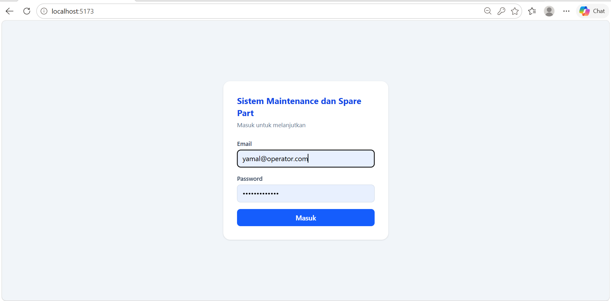
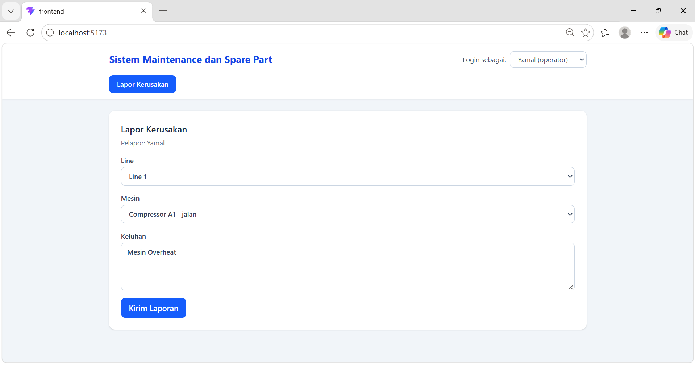
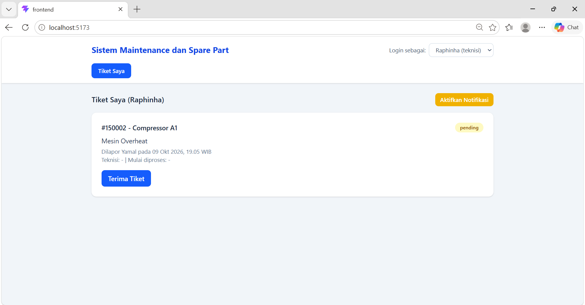
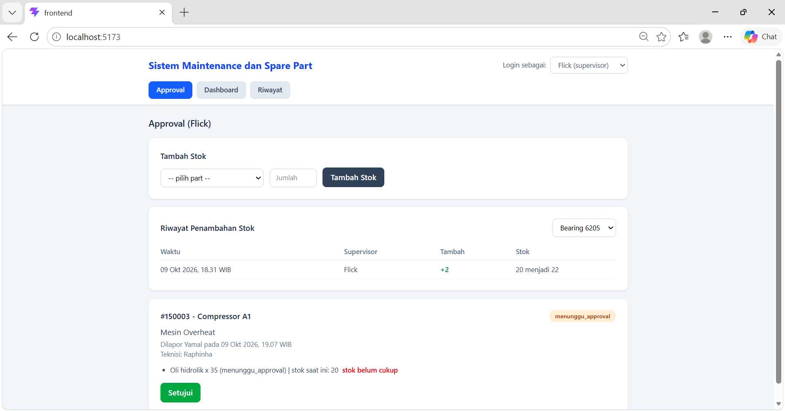
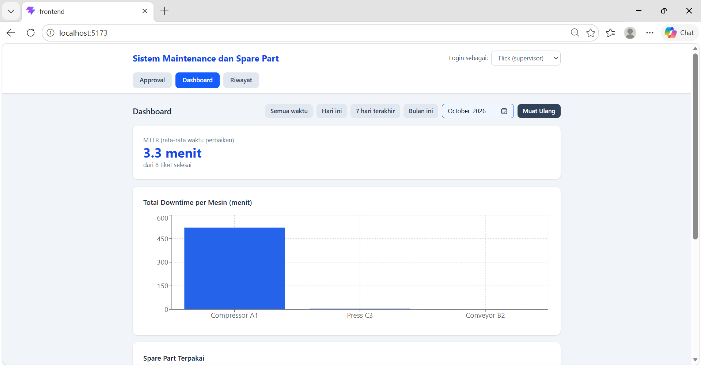
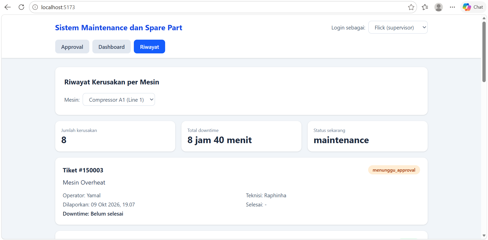
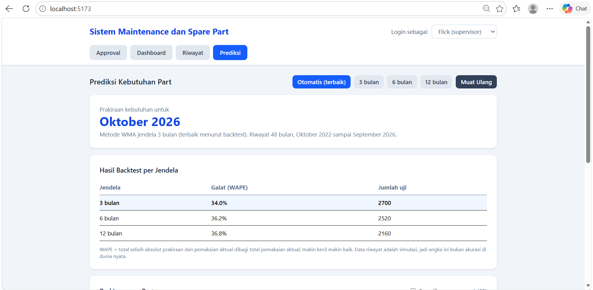
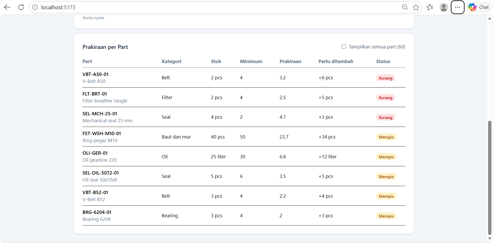

# Sistem Maintenance dan Spare Part

Aplikasi web untuk mengelola tiket kerusakan mesin produksi, penggunaan spare part, dan preventive maintenance. Kerusakan dilaporkan oleh Leader Divisi, ditangani bertahap (Leader, Installer), disahkan lewat surat digital yang ditandatangani Foreman dan SPV Divisi, lalu ditugaskan oleh SPV Maintenance kepada mekanik. Supervisor memantau dashboard downtime, MTTR, stok, laporan bulanan, dan prediksi kebutuhan part.

Proyek ini dikembangkan berdasarkan pengalaman PKL di bagian Maintenance PT TD Automotive Compressor Indonesia (2019), sehingga alur aplikasi disesuaikan dengan proses pengelolaan spare part dan perbaikan mesin di lapangan.

## Screenshot

### 1. Login

| Halaman Login |
|---|
|  |

### 2. Operator

| Lapor Kerusakan |
|---|
|  |

### 3. Teknisi dan Mekanik Maintenance

| Tiket Saya | Tiket dari TTD Surat |
|---|---|
|  |  |

### 4. Supervisor dan SPV Maintenance

| Approval dan Riwayat Stok | Tambah Stok |
|---|---|
|  |  |

| Dashboard | Riwayat Kerusakan per Mesin |
|---|---|
|  |  |

| Prediksi Kebutuhan Part | Prediksi per Part |
|---|---|
|  |  |

| Jadwal Preventive Maintenance | Laporan Bulanan |
|---|---|
|  |  |

| QR Mesin |
|---|
|  |

## Peran dan Divisi

Aplikasi memiliki sembilan peran. Peran divisi terikat pada divisi tertentu (A sampai D), sedangkan peran maintenance berlaku untuk semua divisi (`ALL`).

| Peran | Kode | Tugas |
|---|---|---|
| Operator | `operator` | Melaporkan kerusakan (alur lama) |
| Teknisi | `teknisi` | Menangani tiket, memakai part (alur lama) |
| Supervisor | `supervisor` | Menyetujui part, menambah stok, memantau dashboard (alur lama) |
| Leader Divisi | `leader_divisi` | Melaporkan kerusakan lewat QR, menyelesaikan sendiri atau meneruskan ke Installer |
| Installer Divisi | `installer_divisi` | Menyelesaikan sendiri atau membuat surat; membawa perangkat untuk tanda tangan di tempat |
| Foreman Divisi | `foreman_divisi` | Menandatangani surat (slot Foreman) |
| SPV Divisi | `spv_divisi` | Menandatangani surat (slot SPV Divisi); berbeda dari SPV Maintenance |
| SPV Maintenance | `spv_mtnc` | Menugaskan mekanik, menyetujui part, menambah stok, mengelola jadwal PM, memantau dashboard |
| Mekanik Maintenance | `mekanik_mtnc` | Mengerjakan tiket yang ditugaskan dan memakai part |

Peran Leader, Installer, Foreman, dan SPV Divisi hanya dapat melihat dan memproses tiket dari divisinya sendiri. Divisi pengguna dibaca dari database pada setiap request, bukan dari token.

## Fitur

### Semua Peran
- Login menggunakan email dan password.
- Pembatasan akses berdasarkan peran pengguna.
- API memvalidasi hak akses agar pengguna tidak dapat menjalankan tindakan di luar kewenangannya.

### Leader Divisi
- Memindai QR Code mesin untuk membuka form lapor kerusakan dengan mesin yang sudah terisi.
- Hanya dapat melaporkan mesin dari divisinya.
- Menyelesaikan tiket sendiri, atau meneruskannya ke Installer dengan laporan Leader.

### Installer Divisi
- Menyelesaikan tiket sendiri, atau membuat surat dengan laporan Installer. Laporan permasalahan disusun otomatis dari keluhan, laporan Leader, dan laporan Installer.
- Membawa perangkat untuk pengambilan tanda tangan Foreman dan SPV Divisi di tempat.

### Foreman dan SPV Divisi
- Melihat antrean surat yang menunggu tanda tangan, difilter divisi dan slot milik masing-masing.
- Menandatangani surat secara langsung dari akun sendiri.

### SPV Maintenance dan Mekanik
- SPV Maintenance melihat antrean tiket yang sudah lengkap tanda tangannya, lalu menugaskan mekanik.
- Mekanik melihat tiket yang ditugaskan kepadanya, memakai spare part, dan menyelesaikan maintenance.
- Notifikasi tiket baru melalui polling setiap 6 detik, bunyi beep, dan Notification API browser (alur lama).

### Operator dan Teknisi (alur lama)
- Operator melaporkan kerusakan, teknisi menerima tiket, memakai part, dan menyelesaikan tiket.

### Supervisor dan SPV Maintenance
- Menyetujui permintaan penggunaan spare part ketika stok tidak mencukupi.
- Menambah stok spare part dan melihat riwayat penambahan stok setiap part.
- Mencari spare part berdasarkan nomor part atau kategori.
- Memantau total downtime per mesin.
- Melihat spare part yang paling sering digunakan.
- Memantau MTTR (*Mean Time to Repair*), yaitu rata-rata waktu perbaikan.
- Melihat peringatan stok menipis.
- Memfilter dashboard berdasarkan periode atau bulan tertentu.
- Melihat riwayat kerusakan setiap mesin, spare part yang digunakan, dan lama downtime.
- Mengelola jadwal preventive maintenance.
- Melihat laporan bulanan dan mencetaknya.
- Mencetak QR Code untuk setiap mesin.
- Memperkirakan kebutuhan spare part menggunakan metode Weighted Moving Average (WMA).

Fitur prediksi membandingkan jendela historis 3, 6, dan 12 bulan melalui backtesting, kemudian memilih jendela dengan nilai WAPE terkecil untuk menghasilkan estimasi kebutuhan part dan status stok.

## Alur Tiket

### Alur Divisi (utama)

```text
Leader melapor lewat QR           (mesin: rusak)
        |
        v
  ditangani_leader
        |-- Leader selesai ---------------------------> selesai (mesin: jalan)
        '-- Leader teruskan + laporan Leader
                        |
                        v
              ditangani_installer
                        |-- Installer selesai ---------> selesai (mesin: jalan)
                        '-- Installer buat surat + laporan Installer
                                        |
                                        v
                                  menunggu_ttd
                      (TTD Foreman dan TTD SPV Divisi, urutan bebas)
                                        |
                                        v  (kedua tanda tangan terisi)
                          menunggu_assign_spv_mtnc
                                        |
                                        v  (SPV Maintenance memilih mekanik)
                            diproses_maintenance   (mesin: maintenance)
                                        |
                                        v  (mekanik menyelesaikan)
                                     selesai       (mesin: jalan)
```

Pada tahap `diproses_maintenance`, pemakaian part memakai mekanisme yang sama dengan alur lama: jika stok kurang, tiket masuk `menunggu_approval`, disetujui SPV Maintenance, lalu mekanik menekan Lanjut.

Beberapa aturan alur divisi:
- Setiap langkah memeriksa bahwa tiket berasal dari divisi pengguna.
- Perpindahan status memakai transaksi dengan penguncian baris (`SELECT ... FOR UPDATE`), sehingga dua permintaan bersamaan tidak saling menimpa. Status yang sudah berubah ditolak dengan `409`.
- Tanda tangan yang sudah tersimpan tidak dapat ditimpa (`409`).
- Downtime dihitung dari tiket dibuat sampai selesai, sehingga sengaja mencakup seluruh proses termasuk menunggu tanda tangan.

### Tanda Tangan Surat

Tanda tangan dikirim sebagai gambar PNG dalam format Base64 (maksimal 1.000.000 karakter). Server memeriksa format, panjang, dan *signature* file PNG sebelum menyimpannya. Setiap tanda tangan mencatat nama penanda tangan, waktu, gambar, dan kolom `via`.

Ada dua cara penandatanganan:
1. **Di tempat (mode Installer).** Installer membawa perangkat, memilih penanda tangan dari divisi yang sama, lalu penanda tangan menggambar tanda tangannya. Server memeriksa role dan divisi penanda tangan, dan mencatat id Installer pada kolom `via`.
2. **Langsung.** Foreman atau SPV Divisi login dengan akunnya sendiri dan mengisi slot sesuai rolenya. Penanda tangan diambil dari token, dan kolom `via` kosong.

Begitu slot Foreman dan slot SPV Divisi sama-sama terisi, status tiket otomatis berpindah ke `menunggu_assign_spv_mtnc`.

### Alur Lama (akan diganti alur divisi)

```text
pending -> diproses -> selesai
               |
               +-> menunggu_approval
                    (stok part kurang)
                         |
                         v
                 disetujui supervisor
                         |
                         v
                  teknisi melanjutkan
```

Alur ini masih berjalan dan menjadi dasar data riwayat. Tiket preventive maintenance juga masih memakai alur ini.

Pemakaian part dan penambahan stok menggunakan transaksi database dengan penguncian baris melalui `SELECT ... FOR UPDATE`. Mekanisme ini membantu menjaga konsistensi stok ketika beberapa permintaan diproses secara bersamaan.

Tiket yang selesai tidak dihapus, melainkan diubah statusnya agar riwayat dan laporan tetap tersedia.

## Preventive Maintenance (PM)

- Supervisor membuat jadwal PM per mesin dengan interval hari. Jadwal dapat dinonaktifkan, tidak dihapus.
- Job otomatis berjalan sekali saat server mulai dan kemudian setiap satu jam. Job membuat tiket PM untuk jadwal aktif yang sudah jatuh tempo dan belum memiliki tiket PM terbuka.
- Pembuatan tiket PM aman terhadap duplikasi: transaksi per jadwal dengan penguncian baris, dan batas unik pada kombinasi jadwal dan tanggal jatuh tempo.
- Tiket PM tidak mengubah status mesin dan tidak dihitung sebagai downtime atau MTTR kerusakan. Riwayat mesin menampilkan tiket PM dengan lencana PM.
- Setelah tiket PM selesai, jatuh tempo berikutnya dihitung ulang dari tanggal selesai ditambah interval.

## Laporan Bulanan

Laporan bulanan merangkum tiket selesai pada satu bulan: jumlah tiket kerusakan, tiket PM, total downtime, MTTR, penambahan stok, serta tabel tiket selesai beserta part yang dipakai. Laporan dapat dicetak.

## QR Mesin

Setiap mesin memiliki QR Code berisi alamat `?mesin=<id>`. Operator atau Leader memindai QR, masuk, lalu form lapor kerusakan terbuka dengan mesin yang sudah terisi. Halaman QR Mesin dapat dicetak.

## Autentikasi dan Otorisasi

- Password disimpan dalam bentuk hash menggunakan bcrypt dengan salt rounds 10.
- Server menerbitkan JWT (*JSON Web Token*) dengan masa berlaku 8 jam.
- Token memuat identitas pengguna berupa `id`, `nama`, dan `role`. Divisi tidak disimpan di token; divisi dan role dibaca ulang dari database pada endpoint alur divisi.
- JWT ditandatangani menggunakan `JWT_SECRET` yang disimpan dalam `backend/.env`.
- Token dikirim melalui header `Authorization: Bearer <token>`.
- Frontend menyimpan token di `sessionStorage`.
- Identitas dan peran pengguna diambil dari token yang diverifikasi server, bukan dipercaya dari body request.
- Hak akses diperiksa di backend per kelompok peran (`backend/src/middleware/roles.js`), sehingga peran baru tidak otomatis membuka endpoint lama.

## Teknologi

| Bagian | Teknologi |
|---|---|
| Frontend | React 19, Vite 8, TypeScript, Tailwind CSS 4, Recharts |
| Backend | Node.js, Express |
| Database Driver | mysql2 |
| Database | MySQL-compatible, dikembangkan menggunakan TiDB Cloud Starter |
| Autentikasi | JWT dan bcrypt |

## Arsitektur

```text
Frontend (React, port 5173)
            |
            v
Backend API (Express, port 5001)
            |
            v
Database MySQL-compatible
```

## Struktur Folder

```text
maintenance-system/
├── backend/       API Express, routes, dan middleware
├── frontend/      Aplikasi React + TypeScript
├── database/      schema.sql dan seed.sql
└── docs/
    └── screenshots/
```

## Cara Menjalankan

### Persyaratan

- Node.js dan npm.
- Database MySQL-compatible yang sudah dibuat dan dapat diakses.

### 1. Siapkan Database

Jalankan file SQL berikut secara berurutan pada database yang digunakan:

1. `database/schema.sql`
2. `database/seed.sql`

Seed berisi data contoh untuk pengujian aplikasi.

**Catatan:** urutan `CREATE` dan `ALTER` pada `schema.sql` baru diuji pada database yang sudah berjalan, belum pada database yang benar-benar kosong.

### 2. Jalankan Backend

Buka terminal di folder proyek:

```bat
cd backend
copy .env.example .env
npm install
```

Isi `backend/.env` dengan konfigurasi koneksi database dan `JWT_SECRET` milik sendiri.

Untuk membuat secret acak, jalankan:

```bat
node -e "console.log(require('crypto').randomBytes(32).toString('hex'))"
```

Kemudian jalankan backend:

```bat
npm run dev
```

Backend berjalan di `http://localhost:5001`.

### 3. Jalankan Frontend

Buka terminal baru dari folder utama proyek:

```bat
cd frontend
npm install
npm run dev
```

Buka aplikasi melalui:

`http://localhost:5173`

## Akun Demo

Akun berikut digunakan untuk pengujian lokal dan tersedia pada `database/seed.sql`.

| Peran | Email | Password |
|---|---|---|
| Operator | `yamal@operator.com` | `Operator#2026` |
| Mekanik Maintenance | `raphinha@teknisi.com` | `Teknisi#2026` |
| SPV Maintenance | `flick@supervisor.com` | `Supervisor#2026` |

Akun untuk peran divisi (Leader, Installer, Foreman, dan SPV Divisi) tidak dicantumkan di README ini.

**Catatan:** Akun tersebut hanya untuk demo. Jangan gunakan password demo untuk akun produksi.

## Endpoint API

Semua endpoint selain `POST /auth/login` membutuhkan JWT yang valid. Kelompok peran didefinisikan di `backend/src/middleware/roles.js`.

### Autentikasi dan Data Master

| Method | Endpoint | Hak Akses | Fungsi |
|---|---|---|---|
| POST | `/auth/login` | Publik | Login dan memperoleh token |
| GET | `/mesin` | Semua | Mendapatkan daftar mesin |
| GET | `/mesin/:id/riwayat` | Semua | Melihat riwayat tiket mesin |
| GET | `/users` | Semua | Mendapatkan daftar pengguna |

### Spare Part

| Method | Endpoint | Hak Akses | Fungsi |
|---|---|---|---|
| GET | `/spare-parts` | Semua | Mendapatkan daftar spare part |
| POST | `/spare-parts/:id/stok` | Supervisor, SPV Maintenance | Menambah stok spare part |
| GET | `/spare-parts/:id/riwayat` | Semua | Melihat riwayat penambahan stok |

### Alur Divisi

| Method | Endpoint | Hak Akses | Fungsi |
|---|---|---|---|
| POST | `/tiket/alur-divisi/lapor` | Leader Divisi | Melaporkan kerusakan; mesin harus dari divisi Leader |
| GET | `/tiket/alur-divisi` | Leader, Installer | Daftar tiket sesuai tahap dan divisinya |
| PATCH | `/tiket/alur-divisi/:id/aksi` | Leader, Installer | Menjalankan aksi tahap (lihat di bawah) |
| GET | `/tiket/menunggu-ttd` | Installer, Foreman, SPV Divisi | Antrean surat yang menunggu tanda tangan |
| POST | `/tiket/:id/ttd` | Installer, Foreman, SPV Divisi | Menyimpan tanda tangan Foreman atau SPV Divisi |
| GET | `/penugasan-maintenance/antrean` | SPV Maintenance | Tiket yang tanda tangannya sudah lengkap |
| GET | `/penugasan-maintenance/mekanik` | SPV Maintenance | Daftar mekanik yang dapat ditugaskan |
| PATCH | `/penugasan-maintenance/:id/tugaskan` | SPV Maintenance | Menugaskan mekanik (`{ "mekanik_id": 123 }`) |
| GET | `/penugasan-maintenance/tiket-saya` | Mekanik Maintenance | Tiket yang ditugaskan kepada mekanik |
| PATCH | `/penugasan-maintenance/:id/selesai-maintenance` | Mekanik Maintenance | Menyelesaikan maintenance |

Body `PATCH /tiket/alur-divisi/:id/aksi`:

| Peran | `aksi` | Keterangan |
|---|---|---|
| Leader | `selesai` | Menyelesaikan tiket |
| Leader | `teruskan_installer` | Meneruskan ke Installer; `laporan` wajib diisi |
| Installer | `selesai` | Menyelesaikan tiket |
| Installer | `menunggu_ttd` | Membuat surat; `laporan` wajib diisi |

Body `POST /tiket/:id/ttd`:

```json
{
  "sebagai": "foreman",
  "ttd": "data:image/png;base64,...",
  "penanda_tangan_id": 123
}
```

`sebagai` bernilai `foreman` atau `spv`. `penanda_tangan_id` hanya diperlukan saat Installer membawa perangkat; pada penandatanganan langsung, nilai ini diabaikan.

### Alur Lama

| Method | Endpoint | Hak Akses | Fungsi |
|---|---|---|---|
| GET | `/tiket` | Semua | Mendapatkan daftar tiket |
| GET | `/tiket/:id` | Semua | Melihat detail tiket dan part |
| POST | `/tiket` | Operator, Leader Divisi | Melaporkan kerusakan (alur lama) |
| PATCH | `/tiket/:id/terima` | Teknisi, Mekanik | Menerima tiket |
| POST | `/tiket/:id/part` | Teknisi, Mekanik | Menambahkan part ke tiket |
| PATCH | `/tiket/:id/setujui` | Supervisor, SPV Maintenance | Menyetujui penggunaan part |
| PATCH | `/tiket/:id/lanjut` | Teknisi, Mekanik | Melanjutkan proses perbaikan |
| PATCH | `/tiket/:id/selesai` | Teknisi, Mekanik | Menyelesaikan tiket (alur lama) |

### Preventive Maintenance dan Laporan

| Method | Endpoint | Hak Akses | Fungsi |
|---|---|---|---|
| GET | `/pm` | Teknisi, Mekanik, Supervisor, SPV Maintenance | Daftar jadwal PM |
| POST | `/pm` | Supervisor, SPV Maintenance | Membuat jadwal PM |
| PATCH | `/pm/:id` | Supervisor, SPV Maintenance | Mengubah atau menonaktifkan jadwal PM |
| GET | `/laporan/bulanan` | Teknisi, Mekanik, Supervisor, SPV Maintenance | Laporan bulanan |

### Dashboard dan Prediksi

| Method | Endpoint | Hak Akses | Fungsi |
|---|---|---|---|
| GET | `/dashboard/downtime` | Semua | Mendapatkan data downtime per mesin |
| GET | `/dashboard/part-terpakai` | Semua | Melihat part yang paling sering digunakan |
| GET | `/dashboard/mttr` | Semua | Mendapatkan data MTTR |
| GET | `/dashboard/stok-menipis` | Semua | Mendapatkan daftar stok menipis |
| GET | `/prediksi/part` | Semua | Mendapatkan prediksi kebutuhan spare part |

### Parameter API

Endpoint dashboard downtime, part terpakai, dan MTTR mendukung parameter:

- `?periode=semua`
- `?periode=hari`
- `?periode=minggu`
- `?periode=bulan`
- `?bulan=2026-10`

Jika parameter `bulan` dan `periode` dikirim bersamaan, parameter `bulan` yang digunakan.

Endpoint prediksi mendukung pemilihan jendela historis melalui parameter `?jendela=3`, `?jendela=6`, atau `?jendela=12`.

Respons error API menggunakan format JSON, misalnya:

```json
{
  "error": "Pesan kesalahan"
}
```

Kode status yang digunakan mencakup:
- `400 Bad Request`: input tidak valid atau tidak lengkap.
- `401 Unauthorized`: token tidak tersedia atau tidak valid.
- `403 Forbidden`: pengguna tidak memiliki hak akses, atau tiket bukan dari divisinya.
- `404 Not Found`: resource tidak ditemukan, sesuai implementasi endpoint.
- `409 Conflict`: status tiket sudah berubah, atau slot tanda tangan sudah terisi.

## Keterbatasan

- **Tanda tangan di tempat tidak terverifikasi.** Pada mode Installer, tanda tangan Foreman atau SPV Divisi diambil melalui sesi Installer. Server mencatat siapa penanda tangan dan siapa Installer yang membawa perangkat, tetapi tidak memverifikasi kredensial penanda tangan. Keabsahan tanda tangan bergantung pada prosedur (SOP) perusahaan.
- **Alur lama masih hidup.** Alur operator dan teknisi masih berjalan berdampingan dengan alur divisi, dan tiket preventive maintenance masih memakai alur lama.
- **MTTR alur divisi dihitung sejak penugasan.** Waktu mulai (`diproses_at`) diisi saat SPV Maintenance menugaskan mekanik, bukan saat mekanik benar-benar mulai bekerja, karena belum ada langkah "Ambil dan Kerjakan". Akibatnya MTTR tiket alur divisi cenderung lebih panjang.
- **Downtime yang masih berjalan belum tampil di dashboard.** Dashboard menghitung tiket yang sudah selesai; mesin yang masih rusak atau menunggu tanda tangan belum terhitung sampai tiketnya selesai.
- **Kolom Teknisi pada riwayat dan laporan** membaca `teknisi_id`, sedangkan mekanik pada alur divisi tercatat di `ditugaskan_ke`, sehingga nama mekanik dapat tampil kosong untuk tiket alur divisi.
- **Tiket ganda dari Leader.** Endpoint lapor Leader belum memeriksa tiket yang masih terbuka pada mesin yang sama.
- **QR Mesin hanya berfungsi di jaringan lokal.** Alamat aplikasi pada QR adalah `localhost`; agar dapat dipindai dari ponsel, alamat harus diganti dengan alamat jaringan atau hosting.
- Autentikasi menggunakan JWT dengan masa berlaku 8 jam tanpa refresh token.
- Belum tersedia halaman pendaftaran akun dan reset password.
- Logout menghapus token dari browser; token tidak di-blacklist pada server.
- Notifikasi tiket baru menggunakan polling, bunyi beep, dan Notification API browser. Notifikasi melalui Telegram atau WhatsApp belum tersedia.
- Backend belum di-hosting sehingga belum tersedia tautan demo publik.
- Data yang digunakan merupakan data pengujian, termasuk riwayat tiket selama empat tahun untuk menguji fitur prediksi.
- Nilai WAPE pada backtesting mengukur kecocokan metode terhadap data historis yang digunakan, bukan jaminan akurasi pada kondisi produksi nyata.
- Urutan `CREATE` dan `ALTER` pada `database/schema.sql` belum diuji pada database kosong.

## Rencana Pengembangan

- Menutup alur lama dan memindahkan tiket preventive maintenance ke alur penugasan SPV Maintenance.
- Langkah "Ambil dan Kerjakan" oleh mekanik agar MTTR dihitung dari saat pekerjaan benar-benar dimulai.
- Verifikasi tanda tangan dengan PIN per orang.
- Menampilkan jejak tanda tangan (siapa dan kapan) pada Laporan Bulanan.
- Pemeriksaan tiket terbuka pada pelaporan Leader.
- Menampilkan downtime yang sedang berjalan pada dashboard.
- Refresh token.
- Manajemen akun pengguna dan reset password.
- Pengembangan dan evaluasi prediksi menggunakan data operasional nyata.